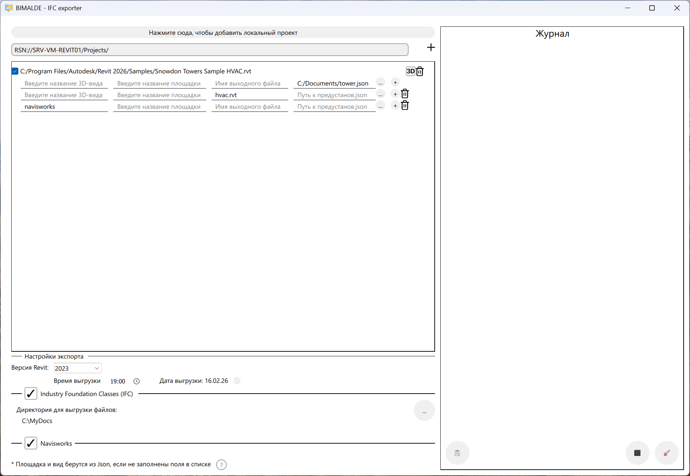

QML designer v18+ , C++ 20

The file main.qml, folders "resources" and "shared" should be placed one level top, than the executable.
The file moc_predefs.h should be in "debug" and "release" folders.

If error "File Makefile doesn't exist" occurs, that means your command-line interpreter cmd.exe runs and operate in wrong directory. As a temporary solution, you could change Sysroot parameter of your Qt Kit to the ifc_exporter's project directory.
Check your registry REG_SZ:
HKEY_LOCAL_MACHINE\SOFTWARE\Microsoft\Command Processor\Autorun

In case of Debugger (e.g. CDB) doesn't work,
turn on Menu Views > Debugger Global Log
probably your error is "debugging failed, Win32 error 0n87 "The parameter is incorrect."
(means "no exe-file find to debug"), just recreate the RUN configuration in Qt

The files src/sensitive_data.h and shared/SensitiveData.qml are not stored in git: on the first qmake run they are created from the *.example templates, after which their values must be replaced with the real ones.
