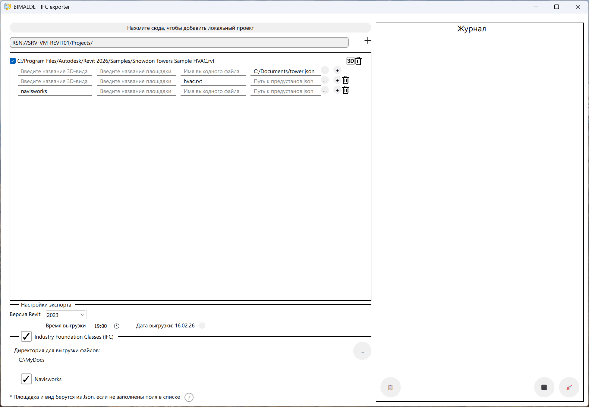

QML designer v18+ , C++ 20

QML and images are embedded in the executable through `ifc_exporter.qrc` and `shared/shared.qrc`; copying `main.qml`, `resources`, or `shared` next to the executable is not required.
`moc_predefs.h` is generated by qmake during the build and must not be copied or tracked in Git.

The bgHelper TCP log protocol uses UTF-8 records terminated by `\n` (CRLF is also accepted). Deploy the matching bgHelper update together with this exporter; older helpers without record delimiters are incompatible.

Immediate export clears `ControlFlags/Date` and `ControlFlags/Time` to prevent a scheduled repeat. Scheduled export preserves the selected date and time. Export settings are saved atomically before enabling export; a configuration or named-pipe error is shown in the log and restores the controls.

If error "File Makefile doesn't exist" occurs, that means your command-line interpreter cmd.exe runs and operate in wrong directory. As a temporary solution, you could change Sysroot parameter of your Qt Kit to the ifc_exporter's project directory.
Check your registry REG_SZ:
HKEY_LOCAL_MACHINE\SOFTWARE\Microsoft\Command Processor\Autorun

In case of Debugger (e.g. CDB) doesn't work,
turn on Menu Views > Debugger Global Log
probably your error is "debugging failed, Win32 error 0n87 "The parameter is incorrect."
(means "no exe-file find to debug"), just recreate the RUN configuration in Qt



The files src/sensitive_data.h and shared/SensitiveData.qml are not stored in git: on the first qmake run they are created from the *.example templates, after which their values must be replaced with the real ones.

Runtime regression tests (Qt 6.10, MSVC 2022 developer command prompt, a separate build directory):

```bat
qmake path\to\qml_ifc_exporter\tests\runtime.pro
jom release
release\exporter_runtime_tests.exe
```

Add the Qt kit's `bin` directory to `PATH` before running the tests. Tests use a temporary INF and the offscreen platform, cover TCP framing and UTF-8, configuration failures, immediate/scheduled launch, and pipe reuse. Stop bgHelper before running them: the immediate-launch test reserves `bghelperpipe` locally and fails if it cannot reserve it.
